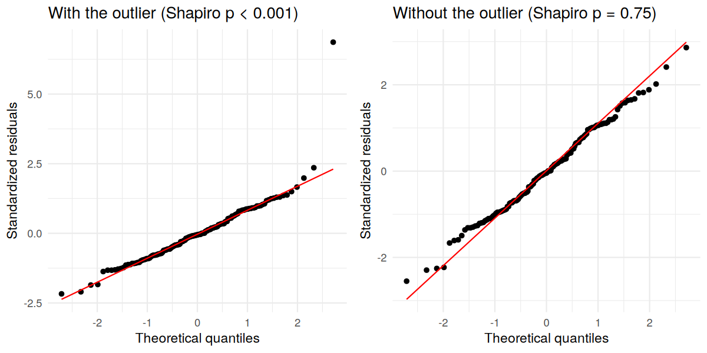
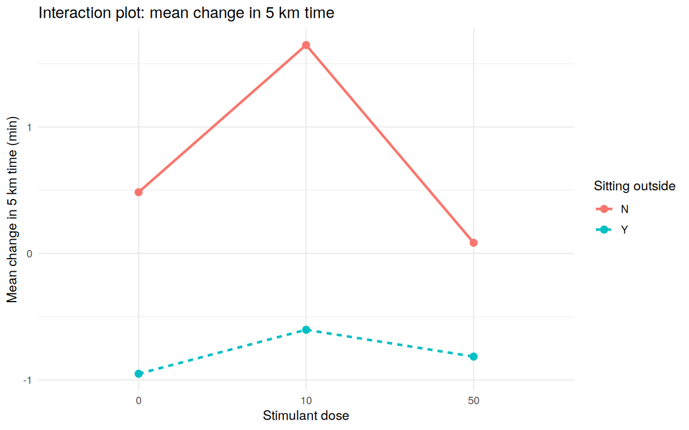
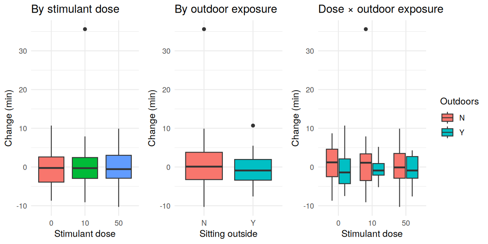

# Stimulant Dose × Outdoor Exposure: A 3×2 Factorial Experiment on 5 km Run Time

This project designs a balanced 3×2 factorial experiment on 150 simulated subjects, tests whether a stimulant and outdoor exposure change 5 km run times, and then **re-validates the analysis the way an independent reviewer would**: checking baseline balance, model assumptions, influential observations, alternative methods, effect sizes and statistical power.

It started as the final project for UCLA STAT 101B (Design and Analysis of Experiments, 2024). Part 2, the re-validation, was added in 2026.

The full analysis, code and output are in [`analysis.md`](analysis.md) (source: [`analysis.Rmd`](analysis.Rmd)).

## Key findings

- **No significant treatment effects.** Neither stimulant dose (p = 0.64) nor outdoor exposure (p = 0.066) nor their interaction (p = 0.80) was significant at the 5% level.
- **The only near-significant result came from one observation.** One subject ran 35.6 minutes slower after treatment (standardized residual 6.9, Cook's distance 0.33, versus 2.4 and 0.04 for the next point). Removing it moved the outdoor effect from p = 0.066 to p = 0.12.
- **The original model violated normality.** Shapiro-Wilk rejected normality at p < 0.001 because of that outlier; without it, normality holds (p = 0.75). Bartlett's test also flagged unequal variance, but the robust Brown-Forsythe test did not, pointing to the same outlier.
- **Every robustness check agrees.** Rank-based tests that keep all 150 subjects, and an ANCOVA adjusted for baseline time and age, all find no significant effects.
- **"Not significant" does not mean "no effect".** The design could detect about a 1.9-minute outdoor difference with 80% power, but the observed difference was about 1.1 minutes. Detecting it reliably would need about 240 subjects per group, roughly three times as many.

## Results

**Outdoor-exposure effect under each check**

| Check                                      | Data kept         | p-value |
| ------------------------------------------ | ----------------- | ------- |
| Two-way ANOVA (original)                   | All 150           | 0.066   |
| Two-way ANOVA without the outlier          | 149               | 0.122   |
| Wilcoxon rank-sum test                     | All 150           | 0.092   |
| ANCOVA (baseline time + age)               | All 150           | 0.070   |
| ANCOVA (baseline time + age), no outlier   | 149               | 0.125   |

**Effect sizes (partial η²)**: dose 0.006, outdoors 0.023, interaction 0.003. Every effect explains less than 2.5% of the variation.







## Data and setup

- **Source:** [The Islands](https://islands.smp.uq.edu.au/), a virtual population simulation built by the University of Queensland for teaching experimental design
- **Subjects:** 150 islanders, 25 in each of the 6 treatment cells
- **Factors:** stimulant dose (methamphetamine as offered in the simulation: 0, 10, 50) and sitting outside (No, Yes)
- **Response:** change in 5 km run time in minutes (after − before)
- **Baseline balance:** baseline run time and gender were balanced across cells; age showed a small imbalance (p = 0.046), so it was added as a covariate

## Methods

| Step                  | Methods                                                              |
| --------------------- | -------------------------------------------------------------------- |
| Design                | Balanced 3×2 factorial, pre/post measurement                         |
| Main model            | Two-way ANOVA with interaction                                       |
| Baseline check        | ANOVA on baseline time and age, chi-squared test on gender           |
| Assumption checks     | Residual plots, Shapiro-Wilk, Bartlett, Brown-Forsythe               |
| Influence             | Standardized residuals, Cook's distance                              |
| Robustness            | Refit without the outlier, rank-based tests, ANCOVA                  |
| Size and power        | Partial η², minimum detectable effect at 80% power                   |

## Limitations

- The data are simulated, so the results describe The Islands population, not real people.
- Each subject has a single before and after measurement, and single-day run times are noisy.
- Removing the outlier is a sensitivity check, not a correction. There is no evidence it is a data error, so it stays in the main analysis.

## How to run

Open `analysis.Rmd` in RStudio and click **Knit**, or run:

```r
install.packages(c("ggplot2", "gridExtra", "rmarkdown"))
rmarkdown::render("analysis.Rmd")
```

## Repository structure

```
├── README.md
├── analysis.Rmd          # full analysis (source)
├── analysis.md           # rendered analysis with output and figures
├── data/
│   └── islands_5km_experiment.csv
└── images/               # figures generated by analysis.Rmd
```
