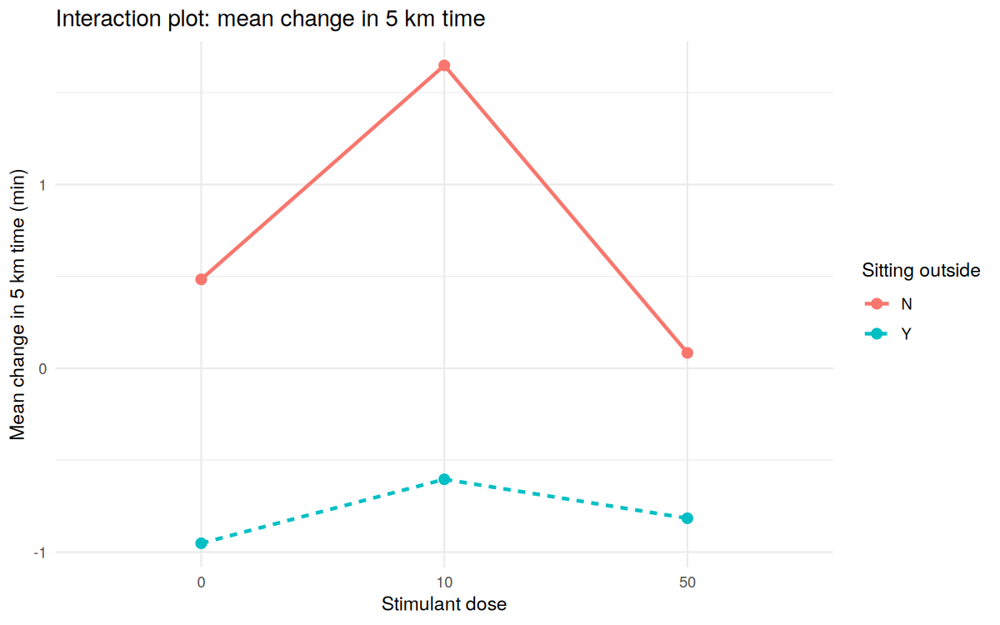
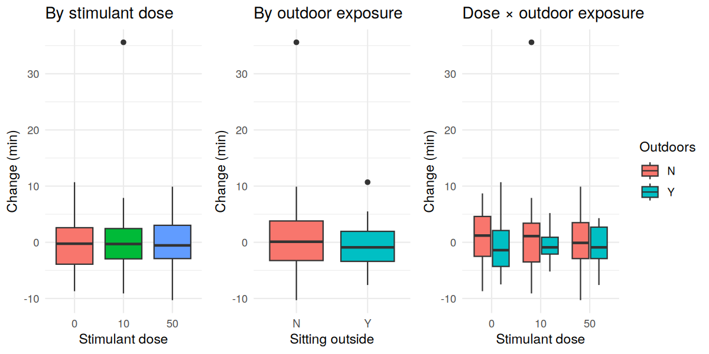
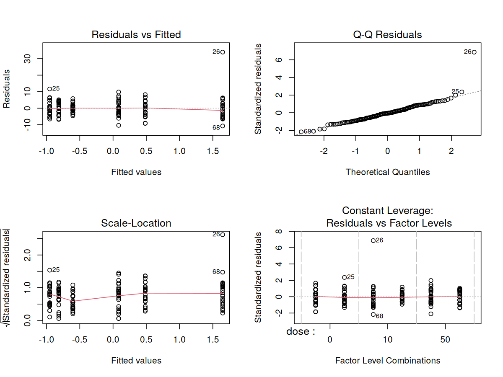
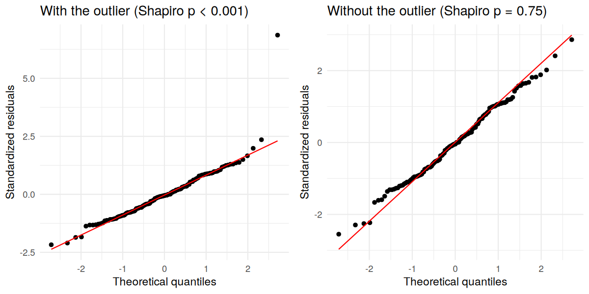

Stimulant Dose × Outdoor Exposure: A 3×2 Factorial Experiment on 5 km
Run Time
================
Jiho Kim

This notebook has two parts. **Part 1** reproduces the original course
analysis (UCLA STAT 101B, Design and Analysis of Experiments). **Part
2** re-validates it the way an independent reviewer would: it checks
whether the groups were comparable, whether the model assumptions hold,
which observations drive the result, and whether the conclusions survive
alternative methods.

# Part 1. Original analysis

## 1.1 Data

The data come from **The Islands**, a virtual population simulation used
for teaching experimental design. Each of 150 islanders ran 5 km before
and after a treatment. The two factors are:

- **Stimulant dose** (methamphetamine, as offered in the simulation): 0,
  10 or 50
- **Outdoor exposure** (sitting outside): No (N) or Yes (Y)

The response is the **change in 5 km time** (after − before, in
minutes). A negative change means the islander ran faster.

``` r
data <- read.csv("data/islands_5km_experiment.csv")
data$change   <- data$after_5km - data$before_5km
data$dose     <- factor(data$Methamphetamine)
data$outdoors <- factor(data$Sitting_outside)

head(data)
```

    ##     Name Age Gender before_5km after_5km Methamphetamine Sitting_outside change
    ## 1  Bindi  68      F       32.0      32.2               0               Y    0.2
    ## 2 Brenda  55      F       21.0      22.0              10               N    1.0
    ## 3 Gretel  20      F       25.2      28.3              50               Y    3.1
    ## 4 Jasmin  70      F       21.4      19.7               0               N   -1.7
    ## 5    Tyr  31      M       23.9      24.8              10               Y    0.9
    ## 6   Nana  32      F       29.5      29.4              50               N   -0.1
    ##   dose outdoors
    ## 1    0        Y
    ## 2   10        N
    ## 3   50        Y
    ## 4    0        N
    ## 5   10        Y
    ## 6   50        N

``` r
# Balanced 3 x 2 design: 25 islanders in every cell
table(Dose = data$dose, Outdoors = data$outdoors)
```

    ##     Outdoors
    ## Dose  N  Y
    ##   0  25 25
    ##   10 25 25
    ##   50 25 25

``` r
# Mean change (minutes) in each cell
round(tapply(data$change, list(Dose = data$dose, Outdoors = data$outdoors), mean), 2)
```

    ##     Outdoors
    ## Dose    N     Y
    ##   0  0.48 -0.95
    ##   10 1.65 -0.60
    ##   50 0.08 -0.82

## 1.2 Two-way ANOVA with interaction

``` r
model <- aov(change ~ dose * outdoors, data = data)
summary(model)
```

    ##                Df Sum Sq Mean Sq F value Pr(>F)  
    ## dose            2     23   11.48   0.450 0.6383  
    ## outdoors        1     88   87.71   3.441 0.0657 .
    ## dose:outdoors   2     12    5.79   0.227 0.7970  
    ## Residuals     144   3671   25.49                 
    ## ---
    ## Signif. codes:  0 '***' 0.001 '**' 0.01 '*' 0.05 '.' 0.1 ' ' 1

No effect is significant at the 5% level. Outdoor exposure is borderline
(p ≈ 0.066), while stimulant dose and the interaction show no effect.

## 1.3 Visualization

``` r
ggplot(data, aes(x = dose, y = change, group = outdoors,
                 color = outdoors, linetype = outdoors)) +
  stat_summary(fun = mean, geom = "line", linewidth = 1) +
  stat_summary(fun = mean, geom = "point", size = 2.5) +
  labs(title = "Interaction plot: mean change in 5 km time",
       x = "Stimulant dose", y = "Mean change in 5 km time (min)",
       color = "Sitting outside", linetype = "Sitting outside") +
  theme_minimal()
```

<!-- -->

``` r
p1 <- ggplot(data, aes(x = dose, y = change, fill = dose)) +
  geom_boxplot() +
  labs(title = "By stimulant dose", x = "Stimulant dose", y = "Change (min)") +
  theme_minimal() + theme(legend.position = "none")

p2 <- ggplot(data, aes(x = outdoors, y = change, fill = outdoors)) +
  geom_boxplot() +
  labs(title = "By outdoor exposure", x = "Sitting outside", y = "Change (min)") +
  theme_minimal() + theme(legend.position = "none")

p3 <- ggplot(data, aes(x = dose, y = change, fill = outdoors)) +
  geom_boxplot() +
  labs(title = "Dose × outdoor exposure", x = "Stimulant dose",
       y = "Change (min)", fill = "Outdoors") +
  theme_minimal()

grid.arrange(p1, p2, p3, ncol = 3, widths = c(1, 1, 1.4))
```

<!-- -->

# Part 2. Re-validation

## 2.1 Were the groups comparable at baseline?

If the treatment groups already differed before the treatment, any
difference afterwards could come from that imbalance rather than the
treatment.

``` r
summary(aov(before_5km ~ dose * outdoors, data = data))   # baseline 5 km time
```

    ##                Df Sum Sq Mean Sq F value Pr(>F)
    ## dose            2    358  178.94   2.254  0.109
    ## outdoors        1      8    7.57   0.095  0.758
    ## dose:outdoors   2    215  107.48   1.354  0.262
    ## Residuals     144  11434   79.40

``` r
summary(aov(Age ~ dose * outdoors, data = data))          # age
```

    ##                Df Sum Sq Mean Sq F value Pr(>F)  
    ## dose            2    103    51.7   0.139 0.8701  
    ## outdoors        1      0     0.2   0.001 0.9798  
    ## dose:outdoors   2   2341  1170.3   3.152 0.0457 *
    ## Residuals     144  53459   371.2                 
    ## ---
    ## Signif. codes:  0 '***' 0.001 '**' 0.01 '*' 0.05 '.' 0.1 ' ' 1

``` r
chisq.test(table(data$Gender, interaction(data$dose, data$outdoors)))  # gender
```

    ## 
    ##  Pearson's Chi-squared test
    ## 
    ## data:  table(data$Gender, interaction(data$dose, data$outdoors))
    ## X-squared = 3.4433, df = 5, p-value = 0.632

Baseline run time and gender are balanced across cells. Age shows a
small imbalance in the interaction term (p ≈ 0.046), so age is added as
a covariate in the ANCOVA in section 2.6 to check whether it matters.

## 2.2 Are the ANOVA assumptions met?

``` r
par(mfrow = c(2, 2))
plot(model)
```

<!-- -->

``` r
# Normality of residuals
shapiro.test(residuals(model))
```

    ## 
    ##  Shapiro-Wilk normality test
    ## 
    ## data:  residuals(model)
    ## W = 0.87025, p-value = 3.779e-10

``` r
# Equal variance: Bartlett (sensitive to non-normality)
bartlett.test(change ~ interaction(dose, outdoors), data = data)
```

    ## 
    ##  Bartlett test of homogeneity of variances
    ## 
    ## data:  change by interaction(dose, outdoors)
    ## Bartlett's K-squared = 36.909, df = 5, p-value = 6.245e-07

``` r
# Equal variance: Brown-Forsythe (robust to non-normality)
brown_forsythe <- function(d) {
  cell   <- interaction(d$dose, d$outdoors)
  absdev <- abs(d$change - ave(d$change, cell, FUN = median))
  summary(aov(absdev ~ cell))[[1]][1, "Pr(>F)"]
}
brown_forsythe(data)
```

    ## [1] 0.09114239

Normality fails badly (p \< 0.001), and the Q-Q plot shows one point far
above the rest. Bartlett’s test also rejects equal variance, but the
robust Brown-Forsythe test does not (p ≈ 0.09). This suggests the
variance problem is largely a side effect of the same non-normality.

## 2.3 Finding the outlier

``` r
fit <- lm(change ~ dose * outdoors, data = data)
std_res <- rstandard(fit)
cooks   <- cooks.distance(fit)
out_row <- which.max(std_res)

round(sort(std_res, decreasing = TRUE)[1:3], 2)   # top 3 standardized residuals
```

    ##   26   25  120 
    ## 6.86 2.36 1.98

``` r
round(sort(cooks,   decreasing = TRUE)[1:3], 3)   # top 3 Cook's distances
```

    ##    26    25    68 
    ## 0.327 0.039 0.033

``` r
data[out_row, c("Name", "Age", "before_5km", "after_5km", "change",
                "dose", "outdoors")]
```

    ##    Name Age before_5km after_5km change dose outdoors
    ## 26 Kaya  37       36.7      72.3   35.6   10        N

One islander ran 5 km **35.6 minutes slower** after treatment. Its
standardized residual (6.9) and Cook’s distance (0.33) are both far
larger than the next observation (2.4 and 0.04), so it stands clearly
apart.

The data give no reason to call this point an error, so it is **kept**
in the main results. The checks below ask a different question: would
the conclusions change without it?

## 2.4 Sensitivity analysis: refit without the outlier

``` r
data_wo  <- data[-out_row, ]
model_wo <- aov(change ~ dose * outdoors, data = data_wo)
summary(model_wo)
```

    ##                Df Sum Sq Mean Sq F value Pr(>F)
    ## dose            2    0.8    0.40   0.023  0.977
    ## outdoors        1   41.8   41.79   2.420  0.122
    ## dose:outdoors   2    2.7    1.35   0.078  0.925
    ## Residuals     143 2469.9   17.27

``` r
shapiro.test(residuals(model_wo))   # normality is restored
```

    ## 
    ##  Shapiro-Wilk normality test
    ## 
    ## data:  residuals(model_wo)
    ## W = 0.99362, p-value = 0.7543

``` r
brown_forsythe(data_wo)             # equal variance still not rejected
```

    ## [1] 0.0785113

``` r
p_with    <- summary(model)[[1]][1:3, "Pr(>F)"]
p_without <- summary(model_wo)[[1]][1:3, "Pr(>F)"]
data.frame(term = c("Dose", "Outdoors", "Dose:Outdoors"),
           p_with_outlier = round(p_with, 3),
           p_without_outlier = round(p_without, 3))
```

    ##            term p_with_outlier p_without_outlier
    ## 1          Dose          0.638             0.977
    ## 2      Outdoors          0.066             0.122
    ## 3 Dose:Outdoors          0.797             0.925

Removing a single observation restores normality and moves the outdoor
effect from p = 0.066 to p = 0.12. The only near-significant result was
driven by one islander.

``` r
qq_plot <- function(m, title) {
  r <- data.frame(res = rstandard(lm(m)))
  ggplot(r, aes(sample = res)) +
    stat_qq() + stat_qq_line(color = "red") +
    labs(title = title, x = "Theoretical quantiles",
         y = "Standardized residuals") +
    theme_minimal()
}
grid.arrange(qq_plot(model,    "With the outlier (Shapiro p < 0.001)"),
             qq_plot(model_wo, "Without the outlier (Shapiro p = 0.75)"),
             ncol = 2)
```

<!-- -->

## 2.5 Rank-based tests: robust without deleting any data

Deleting data is not the only way to handle an outlier. Rank-based tests
use the order of the values instead of the values themselves, so one
extreme point has limited influence.

``` r
kruskal.test(change ~ dose, data = data)                    # dose
```

    ## 
    ##  Kruskal-Wallis rank sum test
    ## 
    ## data:  change by dose
    ## Kruskal-Wallis chi-squared = 0.13824, df = 2, p-value = 0.9332

``` r
wilcox.test(change ~ outdoors, data = data, exact = FALSE)  # outdoor exposure
```

    ## 
    ##  Wilcoxon rank sum test with continuity correction
    ## 
    ## data:  change by outdoors
    ## W = 3261.5, p-value = 0.09182
    ## alternative hypothesis: true location shift is not equal to 0

Keeping all 150 islanders, neither factor is significant (dose p = 0.93,
outdoors p = 0.09). This agrees with the conclusion above.

## 2.6 Alternative model: ANCOVA

Instead of analysing the change score, ANCOVA models the after-time
directly and adjusts for each islander’s baseline time. Age is also
added because of the small imbalance found in section 2.1.

``` r
ancova <- lm(after_5km ~ before_5km + Age + dose * outdoors, data = data)
anova(ancova)
```

    ## Analysis of Variance Table
    ## 
    ## Response: after_5km
    ##                Df  Sum Sq Mean Sq  F value  Pr(>F)    
    ## before_5km      1 14413.9 14413.9 583.5931 < 2e-16 ***
    ## Age             1    48.4    48.4   1.9612 0.16356    
    ## dose            2    31.4    15.7   0.6367 0.53055    
    ## outdoors        1    82.4    82.4   3.3368 0.06985 .  
    ## dose:outdoors   2    14.3     7.1   0.2888 0.74959    
    ## Residuals     142  3507.2    24.7                     
    ## ---
    ## Signif. codes:  0 '***' 0.001 '**' 0.01 '*' 0.05 '.' 0.1 ' ' 1

``` r
ancova_wo <- lm(after_5km ~ before_5km + Age + dose * outdoors, data = data_wo)
anova(ancova_wo)
```

    ## Analysis of Variance Table
    ## 
    ## Response: after_5km
    ##                Df  Sum Sq Mean Sq  F value Pr(>F)    
    ## before_5km      1 13587.5 13587.5 805.8373 <2e-16 ***
    ## Age             1    36.1    36.1   2.1423 0.1455    
    ## dose            2     1.6     0.8   0.0468 0.9543    
    ## outdoors        1    40.2    40.2   2.3827 0.1249    
    ## dose:outdoors   2     5.5     2.8   0.1643 0.8486    
    ## Residuals     141  2377.5    16.9                    
    ## ---
    ## Signif. codes:  0 '***' 0.001 '**' 0.01 '*' 0.05 '.' 0.1 ' ' 1

The ANCOVA leads to the same conclusion: no significant treatment
effects, with or without the outlier, and adjusting for age changes
nothing.

## 2.7 Effect sizes

p-values say whether an effect is detectable; effect sizes say how large
it is.

``` r
partial_eta2 <- function(m) {
  tab <- summary(m)[[1]]
  ss  <- tab[, "Sum Sq"]
  round(ss[1:3] / (ss[1:3] + ss[4]), 4)
}
data.frame(term = c("Dose", "Outdoors", "Dose:Outdoors"),
           with_outlier = partial_eta2(model),
           without_outlier = partial_eta2(model_wo))
```

    ##            term with_outlier without_outlier
    ## 1          Dose       0.0062          0.0003
    ## 2      Outdoors       0.0233          0.0166
    ## 3 Dose:Outdoors       0.0031          0.0011

Every effect explains less than 2.5% of the variation in run-time
change.

## 2.8 Power: could this design have detected the effect?

``` r
sd_resid <- sqrt(sum(residuals(model_wo)^2) / model_wo$df.residual)
power.t.test(n = 75, sd = sd_resid, power = 0.8, sig.level = 0.05)
```

    ## 
    ##      Two-sample t test power calculation 
    ## 
    ##               n = 75
    ##           delta = 1.913822
    ##              sd = 4.155968
    ##       sig.level = 0.05
    ##           power = 0.8
    ##     alternative = two.sided
    ## 
    ## NOTE: n is number in *each* group

``` r
# Observed outdoor difference (No minus Yes), without the outlier
diff(rev(tapply(data_wo$change, data_wo$outdoors, mean)))
```

    ##        N 
    ## 1.058234

With 75 islanders per outdoor group, the design had 80% power to detect
a difference of about **1.9 minutes**. The observed outdoor difference
was only about **1.1 minutes**, below that threshold. So “not
significant” here does not prove there is no effect; the experiment was
too small to detect an effect of this size reliably. Detecting a
1.1-minute difference with 80% power would need about 240 islanders per
group, roughly three times as many.

# Conclusions

1.  Neither stimulant dose nor outdoor exposure had a statistically
    significant effect on 5 km run time, and there was no interaction.
2.  The borderline outdoor effect in the original analysis (p = 0.066)
    depended on a single extreme observation; without it, p = 0.12.
3.  The original model violated the normality assumption because of that
    observation. Checking residual diagnostics before trusting a p-value
    would have caught this.
4.  Rank-based tests (which keep all data), an ANCOVA adjusted for
    baseline time and age, and effect sizes all point to the same
    conclusion.
5.  The design could only detect effects of about 1.9 minutes or more.
    The observed outdoor effect (~1.1 minutes) is below that, so a
    larger experiment would be needed to settle the question.

# Limitations

- The data are simulated, so the results describe The Islands, not real
  people.
- The analysis uses a single pre/post measurement per islander; run
  times on any single day are noisy.
- Removing the outlier is a sensitivity check, not a correction. Without
  more information about that islander, there is no basis for excluding
  it from the main analysis.

# Session info

``` r
sessionInfo()
```

    ## R version 4.3.3 (2024-02-29)
    ## Platform: x86_64-pc-linux-gnu (64-bit)
    ## Running under: Ubuntu 24.04.4 LTS
    ## 
    ## Matrix products: default
    ## BLAS:   /usr/lib/x86_64-linux-gnu/blas/libblas.so.3.12.0 
    ## LAPACK: /usr/lib/x86_64-linux-gnu/lapack/liblapack.so.3.12.0
    ## 
    ## locale:
    ##  [1] LC_CTYPE=C.UTF-8       LC_NUMERIC=C           LC_TIME=C.UTF-8       
    ##  [4] LC_COLLATE=C.UTF-8     LC_MONETARY=C.UTF-8    LC_MESSAGES=C.UTF-8   
    ##  [7] LC_PAPER=C.UTF-8       LC_NAME=C              LC_ADDRESS=C          
    ## [10] LC_TELEPHONE=C         LC_MEASUREMENT=C.UTF-8 LC_IDENTIFICATION=C   
    ## 
    ## time zone: Etc/UTC
    ## tzcode source: system (glibc)
    ## 
    ## attached base packages:
    ## [1] stats     graphics  grDevices utils     datasets  methods   base     
    ## 
    ## other attached packages:
    ## [1] gridExtra_2.3 ggplot2_3.4.4
    ## 
    ## loaded via a namespace (and not attached):
    ##  [1] vctrs_0.6.5      cli_3.6.2        knitr_1.45       rlang_1.1.3     
    ##  [5] xfun_0.41        highr_0.10       generics_0.1.3   labeling_0.4.3  
    ##  [9] glue_1.7.0       colorspace_2.1-0 htmltools_0.5.7  scales_1.3.0    
    ## [13] fansi_1.0.5      rmarkdown_2.25   grid_4.3.3       evaluate_0.23   
    ## [17] munsell_0.5.0    tibble_3.2.1     fastmap_1.1.1    yaml_2.3.8      
    ## [21] lifecycle_1.0.4  compiler_4.3.3   dplyr_1.1.4      pkgconfig_2.0.3 
    ## [25] farver_2.1.1     digest_0.6.34    R6_2.5.1         tidyselect_1.2.0
    ## [29] utf8_1.2.4       pillar_1.9.0     magrittr_2.0.3   withr_2.5.0     
    ## [33] tools_4.3.3      gtable_0.3.4
